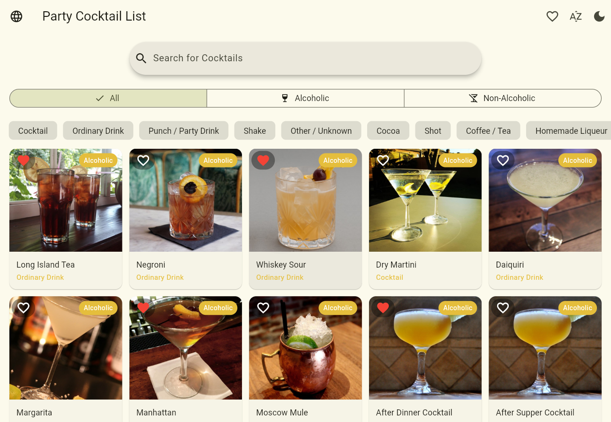
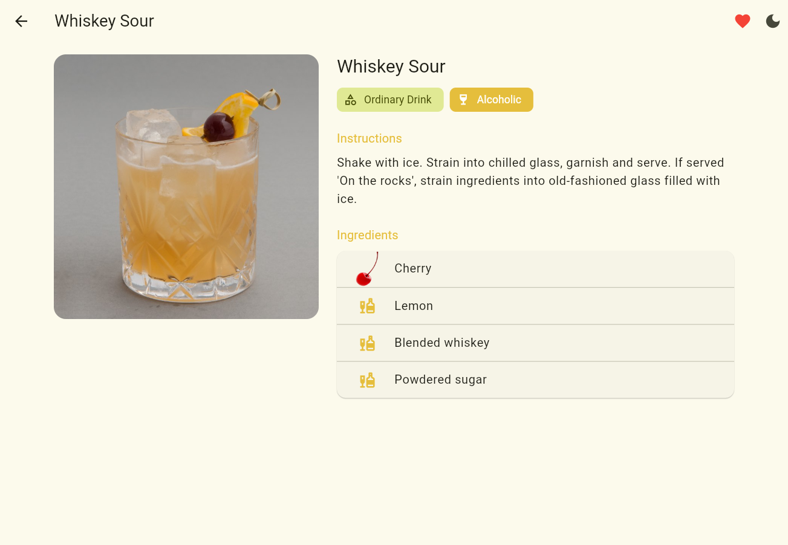
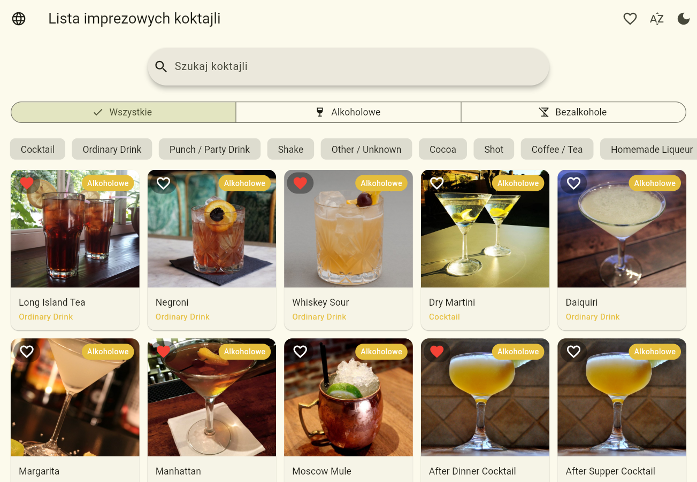
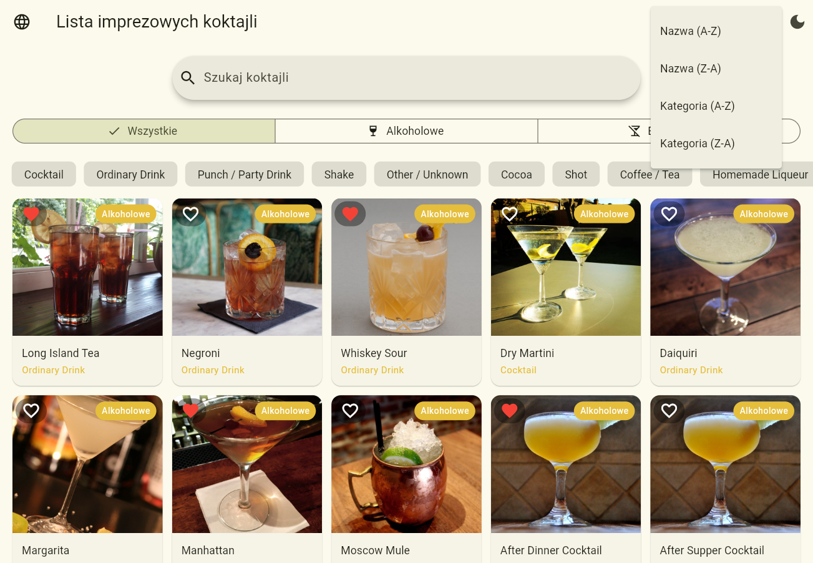
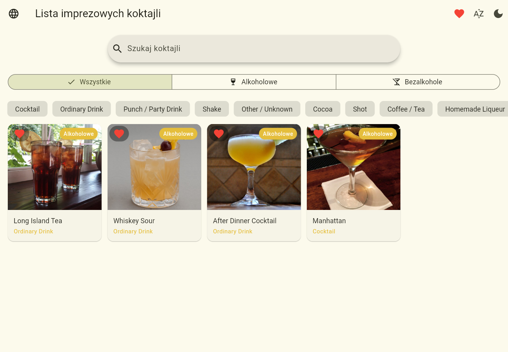
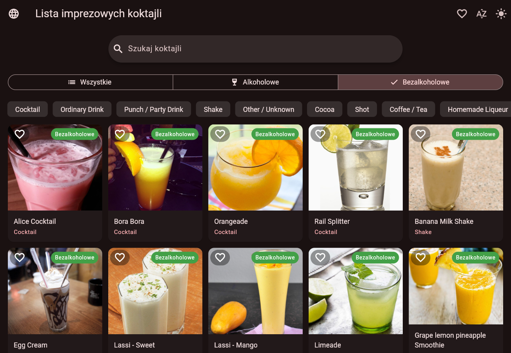
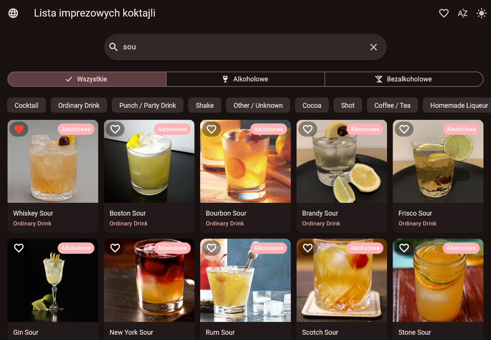

# Cocktail World

Cocktail World to aplikacja we Flutterze, w której można przeglądać koktajle, szukać ich i sprawdzać przepisy. Dane pochodzą z publicznego API: https://cocktails.solvro.pl

## Co potrafi aplikacja

- Pokazuje listę koktajli w siatce, która dopasowuje się do szerokości ekranu.
- Doładowuje kolejne koktajle podczas przewijania listy.
- Wyszukuje koktajle po nazwie. Zapytanie wysyła się chwilę po tym, jak przestaniesz pisać.
- Filtruje koktajle: wszystkie, z alkoholem albo bez alkoholu.
- Filtruje po kategorii (lista kategorii pobiera się z API).
- Sortuje koktajle po nazwie lub kategorii, rosnąco i malejąco.
- Pozwala dodać koktajl do ulubionych (serduszko zmienia kolor) i pokazać tylko ulubione.
- Zapamiętuje ulubione na urządzeniu, więc zostają po wyłączeniu aplikacji.
- Pokazuje szczegóły koktajlu: zdjęcie, instrukcję przygotowania i składniki.
- Ma jasny i ciemny motyw, które przełącza się przyciskiem.
- Działa w dwóch językach (polski i angielski), które przełącza się przyciskiem.
- Zapamiętuje odpowiedzi z listy na 30 minut, żeby mniej pobierać z internetu.
- Pokazuje komunikat o błędzie z przyciskiem "Spróbuj ponownie".

## Technologie

- Flutter i Dart
- API: https://cocktails.solvro.pl
- Zarządzanie stanem: Provider

## Użyte biblioteki

- **provider** - przechowuje stan aplikacji (lista koktajli, filtry, ulubione, motyw) i odświeża ekrany, gdy coś się zmieni.
- **http** - wysyła zapytania do API.
- **freezed** i **freezed_annotation** - generują modele danych (`Cocktail`, `Ingredient`), które nie zmieniają się po utworzeniu. (P.S dzięki Bogu to istnieje)
- **json_serializable** i **json_annotation** - zamieniają JSON z API na obiekty w Dart.
- **build_runner** - uruchamia generowanie kodu dla freezed i json_serializable.
- **shared_preferences** - zapisuje na urządzeniu ulubione koktajle i zapamiętane odpowiedzi z API.
- **easy_localization** - obsługuje tłumaczenia (pliki w folderze `translate/`).
- **chips_choice** - pokazuje poziomą listę kategorii do wyboru.
- **flutter_lints** - podpowiada dobre praktyki w kodzie.

## Struktura projektu

- `lib/models` - modele danych (koktajl, składnik)
- `lib/providers` - stan aplikacji (koktajle, ulubione, motyw)
- `lib/services` - komunikacja z API i zapamiętywanie odpowiedzi
- `lib/screens` - ekrany (lista koktajli, szczegóły)
- `lib/widgets` - małe, wspólne elementy (przycisk ulubionych)
- `translate` - pliki tłumaczeń (`pl.json`, `en.json`)

## Screenshoty

## Uwagi

Nie używam wszystkich pól z API. Dodawanie kolejnych byłoby tylko kwestią wyglądu, a nie pokazaniem moich umiejętności, więc wziąłem tylko to, co potrzebne do działania aplikacji. Z koktajlu używam: nazwy, kategorii, instrukcji, zdjęcia, informacji o alkoholu i składników. Pomijam na przykład rodzaj szklanki i daty utworzenia.
